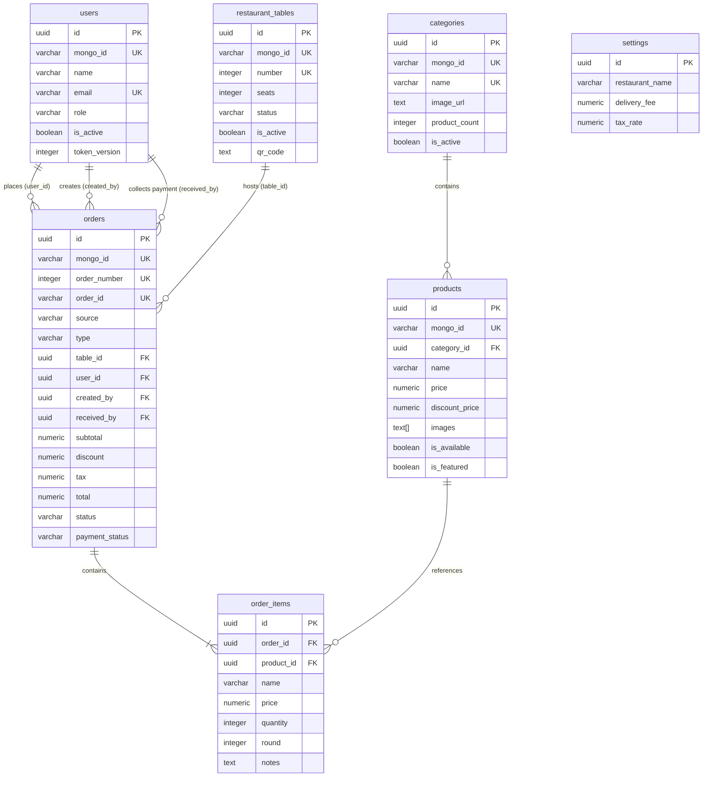

# MongoDB to Supabase (PostgreSQL) Migration Analysis & Architecture Report

## Executive Summary
This report documents the comprehensive backend codebase analysis of the **Restaurant Management & POS System** (featuring Customer Website, POS Cashier Terminal, Kitchen Display System [KDS], Waiter Table Ordering, and Admin Management Panel). 

The target database is **Supabase PostgreSQL**. The complete schema has been generated in:
`supabase/migrations/001_initial_schema.sql`

---

## 1. Discovered MongoDB Collections & Mongoose Schemas

Across the codebase (`server/src/models/`, `server/src/controllers/`, `server/src/routes/`, `server/src/services/`), the following **8 Mongoose collections / schemas** were identified:

| # | MongoDB Collection | Mongoose Model | Primary File | Purpose |
|---|---|---|---|---|
| 1 | `users` | `User` | `server/src/models/user.js` | Customers, Admins, Cashiers, Waiters, Kitchen Staff |
| 2 | `categories` | `Category` | `server/src/models/Category.js` | Menu categories (Burgers, Drinks, Desserts, etc.) |
| 3 | `products` | `Product` | `server/src/models/Product.js` | Menu catalog items, pricing, images, stock availability |
| 4 | `menuitems` | `MenuItem` | `server/src/models/MenuItem.js` | Legacy/fallback restaurant dishes |
| 5 | `tables` | `Table` | `server/src/models/Table.js` | Dine-in restaurant tables, seats/capacity, QR codes |
| 6 | `orders` | `Order` | `server/src/models/Order.js` | Online delivery, POS takeaway, Dine-in table orders |
| 7 | *(subdocuments)* `items` | *(embedded)* | `server/src/models/Order.js` | Line items with quantity, pricing, round, chef notes |
| 8 | `settings` | `Setting` | `server/src/models/Setting.js` | Restaurant brand, phone, hours, delivery fee, tax rate |
| 9 | `counters` | `Counter` | `server/src/models/Counter.js` | Sequential order number generator (`order: seq`) |

---

## 2. Detailed Entity & Field Mapping Matrix

### 2.1 Collection: `users` → Table: `users`
Represents all user accounts: customers, elevated staff (admin, cashier, waiter, kitchen), and legacy accounts.

| MongoDB Field | MongoDB Type | Validation / Rules | PostgreSQL Column | PostgreSQL Type & Constraints |
|---|---|---|---|---|
| `_id` | `ObjectId` | Auto-generated PK | `id` | `UUID PRIMARY KEY DEFAULT gen_random_uuid()` |
| `_id` | `ObjectId` | Historical reference | `mongo_id` | `VARCHAR(24) UNIQUE` (for historical migration) |
| `name` | `String` | Required, trim, 2-60 chars | `name` | `VARCHAR(60) NOT NULL CHECK (char_length(trim(name)) >= 2)` |
| `email` | `String` | Required, unique, lower, max 254 | `email` | `VARCHAR(254) NOT NULL UNIQUE` (regex verified) |
| `phone` | `String` | Optional, trim, max 25, default `""` | `phone` | `VARCHAR(25) NOT NULL DEFAULT ''` |
| `passwordHash` | `String` | Bcrypt hash (12 rounds) | `password_hash` | `VARCHAR(255)` |
| `password` | `String` | Legacy fallback field | `legacy_password` | `VARCHAR(255)` |
| `role` | `String` | enum: `customer, admin, kitchen, cashier, waiter, user` | `role` | `VARCHAR(20) NOT NULL DEFAULT 'customer' CHECK (role IN (...))` |
| `isActive` | `Boolean` | Default `true` | `is_active` | `BOOLEAN NOT NULL DEFAULT true` |
| `tokenVersion` | `Number` | Default `0`, incremented on password/role change | `token_version` | `INTEGER NOT NULL DEFAULT 0` |
| `lastLoginAt` | `Date` | Selected in `staffRoutes.js` | `last_login_at` | `TIMESTAMPTZ NULL` |
| `createdAt` | `Date` | Timestamp | `created_at` | `TIMESTAMPTZ NOT NULL DEFAULT CURRENT_TIMESTAMP` |
| `updatedAt` | `Date` | Timestamp | `updated_at` | `TIMESTAMPTZ NOT NULL DEFAULT CURRENT_TIMESTAMP` |

---

### 2.2 Collection: `categories` → Table: `categories`
Organizes products into catalog groups.

| MongoDB Field | MongoDB Type | Validation / Rules | PostgreSQL Column | PostgreSQL Type & Constraints |
|---|---|---|---|---|
| `_id` | `ObjectId` | Auto-generated PK | `id` | `UUID PRIMARY KEY DEFAULT gen_random_uuid()` |
| `name` | `String` | Required, trim, 2-60 chars | `name` | `VARCHAR(60) NOT NULL` (Case-insensitive unique index) |
| `description` | `String` | Max 200 chars, default `""` | `description` | `VARCHAR(200) NOT NULL DEFAULT ''` |
| `image.url` | `String` | URL string | `image_url` | `TEXT NOT NULL DEFAULT ''` |
| `image.publicId`| `String` | Cloudinary / asset identifier | `image_public_id` | `VARCHAR(100) NOT NULL DEFAULT ''` |
| `productCount` | `Number` | Default 0 | `product_count` | `INTEGER NOT NULL DEFAULT 0` |
| `isActive` | `Boolean` | Default `true` | `is_active` | `BOOLEAN NOT NULL DEFAULT true` |
| `createdAt` | `Date` | Timestamp | `created_at` | `TIMESTAMPTZ NOT NULL DEFAULT CURRENT_TIMESTAMP` |
| `updatedAt` | `Date` | Timestamp | `updated_at` | `TIMESTAMPTZ NOT NULL DEFAULT CURRENT_TIMESTAMP` |

---

### 2.3 Collection: `products` → Table: `products`
The core menu items for online and POS ordering.

| MongoDB Field | MongoDB Type | Validation / Rules | PostgreSQL Column | PostgreSQL Type & Constraints |
|---|---|---|---|---|
| `_id` | `ObjectId` | Auto-generated PK | `id` | `UUID PRIMARY KEY DEFAULT gen_random_uuid()` |
| `name` | `String` | Required, trim, 2-100 chars | `name` | `VARCHAR(100) NOT NULL CHECK (char_length(trim(name)) >= 2)` |
| `description` | `String` | Max 500 chars, default `""` | `description` | `TEXT NOT NULL DEFAULT ''` |
| `price` | `Number` | Required, min 0, max 1,000,000 | `price` | `NUMERIC(10, 2) NOT NULL CHECK (price >= 0)` |
| `discountPrice`| `Number` | Optional, min 0, must be < price | `discount_price` | `NUMERIC(10, 2) NULL CHECK (discount_price < price)` |
| `category` | `ObjectId` | Ref `Category`, required | `category_id` | `UUID NOT NULL REFERENCES categories(id) ON DELETE RESTRICT` |
| `images` | `[String]` | Array of image URLs | `images` | `TEXT[] NOT NULL DEFAULT '{}'` |
| `isFeatured` | `Boolean` | Default `false` | `is_featured` | `BOOLEAN NOT NULL DEFAULT false` |
| `isAvailable` | `Boolean` | Default `true` (86 toggle) | `is_available` | `BOOLEAN NOT NULL DEFAULT true` |
| `createdAt` | `Date` | Timestamp | `created_at` | `TIMESTAMPTZ NOT NULL DEFAULT CURRENT_TIMESTAMP` |
| `updatedAt` | `Date` | Timestamp | `updated_at` | `TIMESTAMPTZ NOT NULL DEFAULT CURRENT_TIMESTAMP` |

---

### 2.4 Collection: `menuitems` → Table: `menu_items`
Legacy/fallback model queried in `orderService.js` line 48.

| MongoDB Field | MongoDB Type | Validation / Rules | PostgreSQL Column | PostgreSQL Type & Constraints |
|---|---|---|---|---|
| `_id` | `ObjectId` | Auto-generated PK | `id` | `UUID PRIMARY KEY DEFAULT gen_random_uuid()` |
| `name` | `String` | Required, trim | `name` | `VARCHAR(100) NOT NULL` |
| `description` | `String` | Optional | `description` | `TEXT NOT NULL DEFAULT ''` |
| `price` | `Number` | Required, min 0 | `price` | `NUMERIC(10, 2) NOT NULL CHECK (price >= 0)` |
| `category` | `String` | Required, string name | `category` | `VARCHAR(100) NOT NULL` |
| `image` | `String` | Optional URL | `image` | `TEXT NOT NULL DEFAULT ''` |
| `isAvailable` | `Boolean` | Default `true` | `is_available` | `BOOLEAN NOT NULL DEFAULT true` |
| `createdAt` | `Date` | Timestamp | `created_at` | `TIMESTAMPTZ NOT NULL DEFAULT CURRENT_TIMESTAMP` |
| `updatedAt` | `Date` | Timestamp | `updated_at` | `TIMESTAMPTZ NOT NULL DEFAULT CURRENT_TIMESTAMP` |

---

### 2.5 Collection: `tables` → Table: `restaurant_tables` (with view `tables`)
Physical dining tables, capacity, QR code identifiers, and live occupancy status.

| MongoDB Field | MongoDB Type | Validation / Rules | PostgreSQL Column | PostgreSQL Type & Constraints |
|---|---|---|---|---|
| `_id` | `ObjectId` | Auto-generated PK | `id` | `UUID PRIMARY KEY DEFAULT gen_random_uuid()` |
| `number` | `Number` | Required, unique, min 1 | `number` | `INTEGER NOT NULL UNIQUE CHECK (number >= 1)` |
| `tableNumber` | `Number` | Synonym synced via hook | `table_number` | `INTEGER` (Auto-synchronized via DB trigger) |
| `seats` | `Number` | Default 4, min 1 | `seats` | `INTEGER NOT NULL DEFAULT 4 CHECK (seats >= 1)` |
| `capacity` | `Number` | Synonym synced via hook | `capacity` | `INTEGER NOT NULL DEFAULT 4` (Auto-synchronized) |
| `status` | `String` | enum: `available, occupied, reserved` | `status` | `VARCHAR(20) NOT NULL DEFAULT 'available'` |
| `isActive` | `Boolean` | Default `true` | `is_active` | `BOOLEAN NOT NULL DEFAULT true` |
| `qrCode` | `String` | URL / payload string | `qr_code` | `TEXT NOT NULL DEFAULT ''` |
| `createdAt` | `Date` | Timestamp | `created_at` | `TIMESTAMPTZ NOT NULL DEFAULT CURRENT_TIMESTAMP` |
| `updatedAt` | `Date` | Timestamp | `updated_at` | `TIMESTAMPTZ NOT NULL DEFAULT CURRENT_TIMESTAMP` |

---

### 2.6 Collection: `orders` → Table: `orders`
Central orders entity for online delivery, pickup, and multi-round dine-in table tickets.

| MongoDB Field | MongoDB Type | Validation / Rules | PostgreSQL Column | PostgreSQL Type & Constraints |
|---|---|---|---|---|
| `_id` | `ObjectId` | Auto-generated PK | `id` | `UUID PRIMARY KEY DEFAULT gen_random_uuid()` |
| `orderNumber` | `Number` | Unique sequential integer (1001+) | `order_number` | `INTEGER UNIQUE DEFAULT nextval('order_number_seq')` |
| `orderId` | `String` | Unique indexed string (`#1001`, `BH-...`) | `order_id` | `VARCHAR(60) NOT NULL UNIQUE` (Auto-generated by trigger) |
| `clientKey` | `String` | Unique sparse idempotency key | `client_key` | `VARCHAR(64) UNIQUE NULL` |
| `source` | `String` | enum: `online, pos`, default `online` | `source` | `VARCHAR(20) NOT NULL DEFAULT 'online'` |
| `type` | `String` | enum: `dine-in, takeaway, delivery` | `type` | `VARCHAR(20) NOT NULL DEFAULT 'delivery'` |
| `table` | `ObjectId` | Ref `Table`, null for delivery/pickup | `table_id` | `UUID REFERENCES restaurant_tables(id) ON DELETE SET NULL` |
| `guestCount` | `Number` | Default 1, min 1 | `guest_count` | `INTEGER NOT NULL DEFAULT 1 CHECK (guest_count >= 1)` |
| `billRequested` | `Boolean` | Default `false` | `bill_requested` | `BOOLEAN NOT NULL DEFAULT false` |
| `billRequestedAt` | `Date` | Timestamp | `bill_requested_at`| `TIMESTAMPTZ NULL` |
| `user` | `ObjectId` | Ref `User` (authenticated customer) | `user_id` | `UUID REFERENCES users(id) ON DELETE SET NULL` |
| `customer.name` / `customerName` | `String` | Flattened customer name | `customer_name` | `VARCHAR(100) NOT NULL DEFAULT ''` |
| `customer.phone` / `phone` | `String` | Flattened phone number | `customer_phone` | `VARCHAR(30) NOT NULL DEFAULT ''` |
| `customer.address` / `address` | `String` | Flattened street address | `customer_address` | `VARCHAR(300) NOT NULL DEFAULT ''` |
| `customer.notes` / `instructions` | `String` | Special delivery/cooking notes | `customer_notes` | `TEXT NOT NULL DEFAULT ''` |
| `instructions` | `String` | Synonymous column | `instructions` | `TEXT NOT NULL DEFAULT ''` (Auto-synchronized) |
| `subtotal` | `Number` | Required, min 0 | `subtotal` | `NUMERIC(10, 2) NOT NULL DEFAULT 0` |
| `discountType`| `String` | enum: `none, percent, amount` | `discount_type` | `VARCHAR(20) NOT NULL DEFAULT 'none'` |
| `discountValue`| `Number` | Numeric percentage or rupees | `discount_value` | `NUMERIC(10, 2) NOT NULL DEFAULT 0` |
| `discount` | `Number` | Total calculated discount, min 0 | `discount` | `NUMERIC(10, 2) NOT NULL DEFAULT 0` |
| `taxRate` | `Number` | Discovered in `orderService.js` (0.05 default) | `tax_rate` | `NUMERIC(5, 4) NOT NULL DEFAULT 0.05` |
| `tax` | `Number` | Calculated tax, min 0 | `tax` | `NUMERIC(10, 2) NOT NULL DEFAULT 0` |
| `deliveryFee` | `Number` | Calculated delivery, min 0 | `delivery_fee` | `NUMERIC(10, 2) NOT NULL DEFAULT 0` |
| `total` | `Number` | Required, min 0 | `total` | `NUMERIC(10, 2) NOT NULL DEFAULT 0` |
| `status` | `String` | enum: `pending, confirmed, preparing, ready, out_for_delivery, delivered, completed, cancelled` | `status` | `VARCHAR(30) NOT NULL DEFAULT 'pending'` |
| `cancelReason`| `String` | Reason string | `cancel_reason` | `TEXT NOT NULL DEFAULT ''` |
| `paymentStatus`| `String` | enum: `unpaid, paid` | `payment_status` | `VARCHAR(20) NOT NULL DEFAULT 'unpaid'` |
| `paymentMethod`| `String` | enum: `cash, cod, card` | `payment_method` | `VARCHAR(20) NOT NULL DEFAULT 'cash'` |
| `paidAt` | `Date` | Timestamp of payment | `paid_at` | `TIMESTAMPTZ NULL` |
| `amountReceived`| `Number` | Cash tendered by customer | `amount_received` | `NUMERIC(10, 2) NULL` |
| `changeGiven` | `Number` | Cash change returned to customer | `change_given` | `NUMERIC(10, 2) NULL` |
| `receivedBy` | `ObjectId` | Ref `User` (Cashier who accepted cash) | `received_by` | `UUID REFERENCES users(id) ON DELETE SET NULL` |
| `createdBy` | `ObjectId` | Ref `User` (Waiter or Cashier) | `created_by` | `UUID REFERENCES users(id) ON DELETE SET NULL` |
| `createdAt` | `Date` | Timestamp | `created_at` | `TIMESTAMPTZ NOT NULL DEFAULT CURRENT_TIMESTAMP` |
| `updatedAt` | `Date` | Timestamp | `updated_at` | `TIMESTAMPTZ NOT NULL DEFAULT CURRENT_TIMESTAMP` |

---

### 2.7 Embedded `Order.items` → Table: `order_items`
In MongoDB, items were stored inside each Order document. In relational PostgreSQL, they are cleanly normalized into `order_items` with full foreign key constraints and cascade deletion.

| MongoDB Field | MongoDB Type | Validation / Rules | PostgreSQL Column | PostgreSQL Type & Constraints |
|---|---|---|---|---|
| *(implicit)* | — | Auto-generated PK | `id` | `UUID PRIMARY KEY DEFAULT gen_random_uuid()` |
| *(parent)* | `ObjectId` | Parent Order reference | `order_id` | `UUID NOT NULL REFERENCES orders(id) ON DELETE CASCADE` |
| `menuItem` | `ObjectId` | Ref `Product` | `product_id` | `UUID REFERENCES products(id) ON DELETE SET NULL` |
| `id` | `String` | Legacy item string ID | `legacy_item_id` | `VARCHAR(80) NULL` |
| `name` | `String` | Item name snapshot | `name` | `VARCHAR(100) NOT NULL` |
| `price` | `Number` | Price snapshot, min 0 | `price` | `NUMERIC(10, 2) NOT NULL CHECK (price >= 0)` |
| `quantity` | `Number` | Min 1, default 1 | `quantity` | `INTEGER NOT NULL DEFAULT 1 CHECK (quantity >= 1)` |
| `qty` | `Number` | Synonymous column | `qty` | `INTEGER NOT NULL DEFAULT 1` (Auto-synchronized) |
| `image` | `String` | Product image URL snapshot | `image` | `TEXT NOT NULL DEFAULT ''` |
| `notes` | `String` | Kitchen item note (e.g. no onion) | `notes` | `TEXT NOT NULL DEFAULT ''` |
| `round` | `Number` | Round number (Round 1, Round 2, etc.) | `round` | `INTEGER NOT NULL DEFAULT 1 CHECK (round >= 1)` |
| *(implicit)* | — | Timestamp | `created_at` | `TIMESTAMPTZ NOT NULL DEFAULT CURRENT_TIMESTAMP` |

---

### 2.8 Collection: `settings` → Table: `settings`
Global restaurant profile, operating hours, and calculation constants.

| MongoDB Field | MongoDB Type | Validation / Rules | PostgreSQL Column | PostgreSQL Type & Constraints |
|---|---|---|---|---|
| `_id` | `ObjectId` | Auto-generated PK | `id` | `UUID PRIMARY KEY DEFAULT gen_random_uuid()` |
| `restaurantName`| `String` | Max 100, default `'Burger House'` | `restaurant_name` | `VARCHAR(100) NOT NULL DEFAULT 'Burger House'` |
| `tagline` | `String` | Max 150 | `tagline` | `VARCHAR(150) NOT NULL DEFAULT 'Artisanal Crafted Burgers & Cafe'` |
| `phone` | `String` | Max 30 | `phone` | `VARCHAR(30) NOT NULL DEFAULT '+92 300 1234567'` |
| `email` | `String` | Max 100 | `email` | `VARCHAR(100) NOT NULL DEFAULT 'contact@burgerhouse.com'` |
| `address` | `String` | Max 200 | `address` | `VARCHAR(200) NOT NULL DEFAULT 'Plot 12-C, Food Street, Phase 5, DHA, Karachi'` |
| `openingHours` | `String` | Max 100 | `opening_hours` | `VARCHAR(100) NOT NULL DEFAULT '12:00 PM – 02:00 AM Daily'` |
| `deliveryFee` | `Number` | Min 0, max 10000, default 150 | `delivery_fee` | `NUMERIC(10, 2) NOT NULL DEFAULT 150` |
| `minOrderAmount`| `Number` | Min 0, default 500 | `min_order_amount`| `NUMERIC(10, 2) NOT NULL DEFAULT 500` |
| *(from code)* | `Number` | Discovered in `orderService.js` (0.05 default) | `tax_rate` | `NUMERIC(5, 4) NOT NULL DEFAULT 0.05` |
| `createdAt` | `Date` | Timestamp | `created_at` | `TIMESTAMPTZ NOT NULL DEFAULT CURRENT_TIMESTAMP` |
| `updatedAt` | `Date` | Timestamp | `updated_at` | `TIMESTAMPTZ NOT NULL DEFAULT CURRENT_TIMESTAMP` |

---

### 2.9 Collection: `counters` → Sequence `order_number_seq` & Table: `counters`
In MongoDB, `Counter.findOneAndUpdate({ _id: "order" }, { $inc: { seq: 1 } })` returned `1000 + seq`.
- In PostgreSQL: A native sequence `order_number_seq START WITH 1001` provides lock-free, atomic sequential IDs.
- For complete backward compatibility with existing Node code, a `counters` table is also created with an initial row `('order', 0)`.

---

## 3. Entity Relationship Diagram (ERD)



---

## 4. Key Architectural Discoveries & Assumptions

1. **`taxRate` in `Setting`:**
   - In `server/src/models/Setting.js`, `taxRate` was not explicitly declared in the schema, yet in `server/src/services/orderService.js` (line 21), `setting?.taxRate != null ? setting.taxRate : 0.05` was queried.
   - **Action:** Added `tax_rate NUMERIC(5, 4) NOT NULL DEFAULT 0.05` to both `settings` and `orders` tables.

2. **Synonymous Fields (`seats`/`capacity`, `number`/`tableNumber`, `qty`/`quantity`, `customer.notes`/`instructions`):**
   - The original Mongoose models used pre-save hooks to mirror synonyms.
   - **Action:** Created PostgreSQL triggers (`sync_table_synonyms`, `sync_order_item_qty`, `generate_order_id`) that automatically keep both columns in sync when inserted or updated.

3. **`MenuItem` vs `Product`:**
   - `Product` has a direct ObjectId reference to `Category` and an array of images.
   - `MenuItem` has a raw string for `category` and single image string. `orderService.js` queried both collections as a fallback.
   - **Action:** Preserved both `products` and `menu_items` tables to ensure 100% data fidelity during migration.

4. **Security & Row Level Security (RLS):**
   - RLS is enabled on all tables.
   - Public queries can only view active categories, available products, active tables, and restaurant settings.
   - Customers can only select their own orders (preventing Insecure Direct Object References - IDOR).
   - Staff roles (`admin`, `cashier`, `kitchen`, `waiter`) and `service_role` have fine-grained permissions matching existing route middleware.

---

## 5. Migration Execution & Verification Guide

Follow these beginner-friendly steps to apply this schema migration to your Supabase project without any risk to your MongoDB data:

### Step 1: Open Supabase SQL Editor
1. Log in to your [Supabase Dashboard](https://supabase.com/dashboard).
2. Open your Restaurant App project.
3. In the left navigation menu, click on the **SQL Editor** icon (represented by the `>_` symbol).
4. Click **New query** (or the green `+` button).

### Step 2: Paste and Run Migration Script
1. Open the file [001_initial_schema.sql](file:///d:/WEB%20DEV%20PROJECTS/Restruent/supabase/migrations/001_initial_schema.sql) in your code editor.
2. Select all (`Ctrl + A`) and Copy (`Ctrl + C`).
3. Paste the contents into the Supabase SQL Editor.
4. Click the green **Run** button (or press `Ctrl + Enter`).
5. You should see the output message:
   ```text
   Success. No rows returned.
   ```

### Step 3: Verify Created Tables & Structure
1. On the left navigation sidebar, click on **Table Editor** (grid icon).
2. Verify that all of the following 9 tables appear in the list:
   - `users`
   - `categories`
   - `products`
   - `menu_items`
   - `restaurant_tables`
   - `orders`
   - `order_items`
   - `settings`
   - `counters`
3. Click on **Database** -> **Schema Visualizer** to see the interactive relationship graph (foreign keys connecting `products` to `categories`, `orders` to `users` and `tables`, and `order_items` to `orders`).

### Step 4: Verify Row Level Security (RLS)
1. Go to **Authentication** -> **Policies** in the Supabase Dashboard.
2. Verify that all 9 tables have **RLS Enabled** (green badge).
3. Review the individual policies created for `public_read`, `customer_read_own`, and `staff_update`.

---
*Generated autonomously by Antigravity IDE after full backend inspection.*
